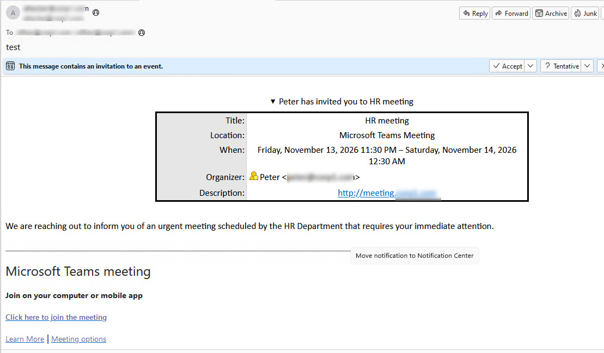

A good technique to make a phishing is using a invitation to an event via emial.

To do that first we need to create a `invitation.ics` file. Here we can see an example:

```
BEGIN:VCALENDAR
PRODID:Microsoft Exchange Server 2022
VERSION:2.0
CALSCALE:GREGORIAN
METHOD:REQUEST
BEGIN:VTIMEZONE
TZID:UTC
BEGIN:STANDARD
DTSTART:20241010T073659Z
TZOFFSETFROM:+0000
TZOFFSETTO:+0000
END:STANDARD
END:VTIMEZONE
BEGIN:VEVENT
DTSTART;TZID=UTC:20261114T073059Z
DTEND;TZID=UTC:20261114T083059Z
DTSTAMP:20241010T034159Z
ORGANIZER;CN=Peter:mailto:peter@victim.com
UID:FIXMEUID20241010T034159Z
CREATED:20241010T034159Z
DESCRIPTION:http://meeting.attacker.com
LAST-MODIFIED:20241010T034159Z
LOCATION:Microsoft Teams Meeting
SEQUENCE:0
STATUS:CONFIRMED
SUMMARY:HR meeting
TRANSP:OPAQUE
END:VEVENT
END:VCALENDAR
```

In order to be successful we need to convince the victim. To do it we can use a template for a teams meeting. `teams.html`

```
<p class=MsoNormal style='background:white'><span style='color:black'>We are reaching out to inform you of an urgent meeting scheduled by the HR Department that requires your immediate attention.<u1:p>&nbsp;<o:p></o:p></span></u1:p></p>
<p class=MsoNormal style='background:white'><span style='color:#5F5F5F'>________________________________________________________________________________</span><span style='mso-fareast-font-family:"Times New Roman";color:black'> <u1:p>&nbsp;</u1:p></span><span style='color:black'><o:p></o:p></span></p>
<p class=MsoNormal style='background:white'><span style='font-size:18.0pt; font-family:"Segoe UI",sans-serif;color:#252424'>Microsoft Teams meeting</span><span style='font-family:"Segoe UI",sans-serif;color:#252424'> <u1:p>&nbsp;</u1:p></span><span style='color:black'><o:p></o:p></span></p>
<p class=MsoNormal style='background:white'><b><span style='font-size:10.5pt; font-family:"Segoe UI",sans-serif;color:#252424'>Join on your computer or mobile app</span></b><b><span style='font-family:"Segoe UI",sans-serif; color:#252424'> <u1:p>&nbsp;</u1:p></span></b><span style='color:black'><o:p></o:p></span></p>
<p class=MsoNormal style='background:white'><span style='font-family:"Segoe UI",sans-serif; color:#252424'><a href="http://attacker.com/" target="_blank"><span style='font-size:10.5pt;font-family:"Segoe UI Semibold",sans-serif; color:#6264A7'>Click here to join the meeting</span></a> <u1:p>&nbsp;</u1:p></span><span style='color:black'><o:p></o:p></span></p>
<p class=MsoNormal style='background:white'><span style='font-family:"Segoe UI",sans-serif; color:#252424'><a href="http://attacker.com/" target="_blank"><span style='font-size:10.5pt;color:#6264A7'>Learn More</span></a> | <a href="http://attacker.com/" target="_blank"><span style='font-size:10.5pt;color:#6264A7'>Meeting options</span></a><u1:p>&nbsp;</u1:p></span><span style='color:black'><o:p></o:p></span></p>
<p class=MsoNormal style='background:white'><span style='color:#5F5F5F'><span style='opacity:.36'>________________________________________________________________________________</span></span><span style='mso-fareast-font-family:"Times New Roman";color:black'> <u1:p>&nbsp;</u1:p></span><span style='color:black'><o:p></o:p></span></p>
```

We use our html template as a email body and we send the `invitation.ics` as an attachment.




> **Note**: We can also use Responder to fake a login and intercept the credentials.